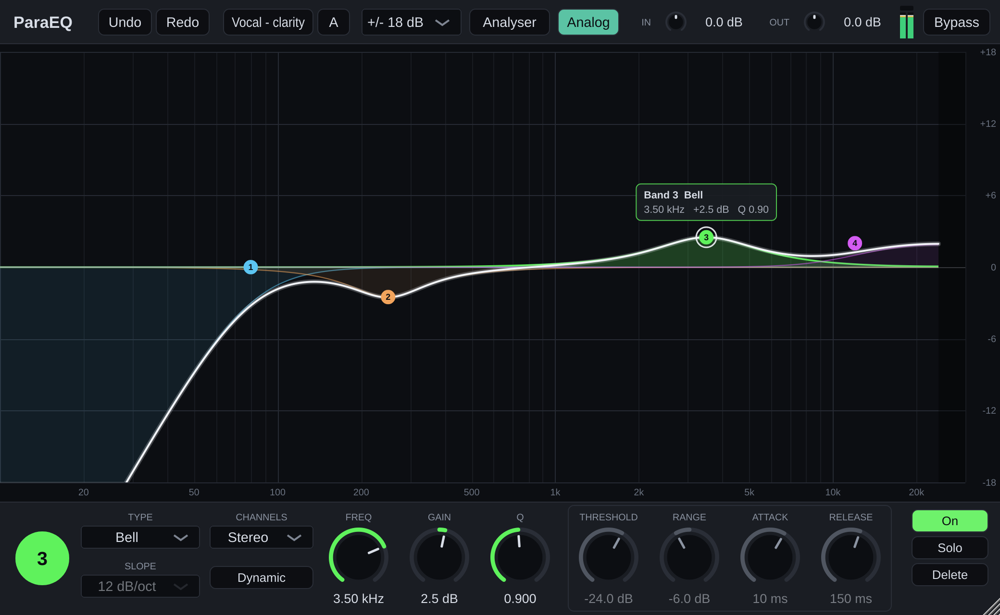

# ParaEQ (working name)

An original parametric EQ plugin (VST3, Windows, for use in Cubase), built with
JUCE and C++17. Personal-use project. No third-party EQ code, names or artwork
is used; all DSP is written from published filter maths.

**Status: all 10 phases done; version 2.3 adds an analyser snapshot (2.2: listen while dragging; 2.1: analyser Left/Right/Side; 2.0: clash view; 1.9: resonance finder; 1.8: side-chain in the analyser; 1.7: Delta listen; 1.6: EQ Match; 1.5: linear-phase mode; 1.4: Auto Gain and look-ahead; 1.3: sidechain and ratio; 1.2: Gain Scale and faster editing; 1.1: analog-matched curves).** 24 working EQ bands (each with its own type, slope
and stereo / left / right / mid / side routing), dynamic EQ on any bell or
shelf, an interactive EQ graph, a real-time spectrum analyser and an output
meter, plus presets, A/B compare and copy/paste of bands.
See [docs/PHASE_REPORT.md](docs/PHASE_REPORT.md). To try it in Cubase, follow
[docs/CUBASE_TESTING.md](docs/CUBASE_TESTING.md).



## Using it

- **Click** anywhere on the graph to add a band (near 20 Hz you get a low cut,
  near 20 kHz a high cut, elsewhere a bell).
- **Drag** a dot: left/right = frequency, up/down = gain. Hold **Shift** for fine moves.
- **Mouse wheel** over a dot = Q (width).
- **Double-click** a dot = reset its gain to 0 dB.
- **Right-click** a dot = type, slope, channels, enable, solo, delete.
- **Analyser** button (top bar) = spectrum settings: off / post / pre / pre+post,
  resolution, speed, peak hold, smoothing, opacity and tilt. The filled
  spectrum is the output (post-EQ), the grey line is the input (pre-EQ).
  Settings are saved with your project.
- **Dynamic** (band panel) makes a bell or shelf react to the level of its own
  frequency region: when that region goes above **Threshold**, the band's gain
  moves by up to **Range** (negative = turn down when loud, e.g. taming harsh
  "s" sounds; positive = turn up when loud). **Attack** / **Release** set how
  fast it reacts and lets go. On the graph a dynamic band shows a bar from its
  dot to where its range ends, a dotted curve for the full range, and the
  live curve it is applying right now.
- **Presets**: click the preset name for factory presets, your own presets,
  Save / Save as / Rename / Delete, Import / Export (.paraeq files) and the
  presets folder. **<** and **>** step through them. A * after the name means
  you have changed something since loading it. Your presets are stored in
  `%APPDATA%\Home Studio\ParaEQ\Presets`.
- **A / B**: the A button switches between two complete settings so you can
  compare; the preset menu can copy one to the other. Both are saved with
  the project.
- **Copy / paste a band**: right-click a dot > Copy band (or select it and
  press Ctrl+C). Ctrl+V pastes it as a new band; right-click > Paste onto
  this band replaces another band. Works between ParaEQ instances too.
- The small meter next to Bypass is the output peak level; it lights red above
  0 dBFS (click it to reset).
- The panel at the bottom shows every setting of the selected band.
- **Undo / Redo** buttons, or Ctrl+Z / Ctrl+Y. **Delete** key removes the selected band.
- **Solo** plays only the frequency region of that band, so you can find what to cut.

## Quick install (no building needed)

Downloads (no GitHub sign-in needed). Builds from `main` are under `latest`;
builds waiting to be merged are under `preview` (same file names):

- Installer: <https://github.com/Joenebula/The-EQs-filter-engine/releases/download/latest/ParaEQ-Setup-Windows-x64.exe>
- Plain zip: <https://github.com/Joenebula/The-EQs-filter-engine/releases/download/latest/ParaEQ-VST3-Windows-x64.zip>
- Manual: <https://github.com/Joenebula/The-EQs-filter-engine/releases/download/latest/ParaEQ-Manual.html>

1. Close Cubase and run the installer (Windows may warn that it is unsigned:
   More info > Run anyway). Or unzip the zip and copy the `ParaEQ.vst3`
   folder into `C:\Program Files\Common Files\VST3\`.
2. In Cubase: **Studio > VST Plug-in Manager**, press **Rescan** if ParaEQ
   doesn't appear.

Full user manual: [docs/USER_MANUAL.md](docs/USER_MANUAL.md) (also built as
`docs/ParaEQ-Manual.html` by `tools/make_manual.py`, and installed with the
plugin).

## Requirements (Windows)

| Tool | Version | Notes |
|---|---|---|
| Visual Studio 2022 | 17.x | "Desktop development with C++" workload |
| CMake | 3.22 or newer | Included with Visual Studio 2022 |
| Git | any | CMake uses it to download JUCE |
| JUCE | 8.0.12 | Downloaded automatically at configure time |

The Steinberg VST3 SDK ships inside JUCE, so no separate download is needed.

JUCE licence: JUCE 8 is dual-licensed (AGPLv3 or a JUCE commercial licence,
which is free for personal use under its revenue threshold). Fine for personal
use; check the licence before ever distributing the plugin.

## Build on Windows

Open "x64 Native Tools Command Prompt for VS 2022", then:

```bat
cd ParametricEQ
cmake -B build -G "Visual Studio 17 2022" -A x64
cmake --build build --config Release
ctest --test-dir build -C Release --output-on-failure
```

To build the installer as well, install Inno Setup 6 and run:

```bat
"C:\Program Files (x86)\Inno Setup 6\ISCC.exe" installer\ParaEQ.iss
```

(output: `build\installer\ParaEQ-Setup-Windows-x64.exe`).

The plugin is written to:

```
build\Source\ParaEQ_artefacts\Release\VST3\ParaEQ.vst3
```

## Install

Copy the whole `ParaEQ.vst3` folder to:

```
C:\Program Files\Common Files\VST3\
```

(or configure with `-DPEQ_COPY_AFTER_BUILD=ON` from an Administrator prompt to
copy it automatically). In Cubase open **Studio > VST Plug-in Manager**, press
**Rescan**, and ParaEQ appears under the vendor "Home Studio", category EQ.

## Build options

| Option | Default | Meaning |
|---|---|---|
| `PEQ_BUILD_PLUGIN` | ON | Build the VST3 (and a standalone app for quick testing) |
| `PEQ_BUILD_TESTS` | ON | Build the DSP tests and the plugin-level tests |
| `PEQ_BUILD_GUI_TESTS` | OFF | Build the headless GUI test (needs a display) |
| `PEQ_JUCE_DIR` | empty | Use a local JUCE checkout instead of downloading |
| `PEQ_COPY_AFTER_BUILD` | OFF | Copy the VST3 into the system folder after building |

DSP tests only (fast, no JUCE download):

```bat
cmake -B build-tests -DPEQ_BUILD_PLUGIN=OFF
cmake --build build-tests --config Release
build-tests\Release\peq_tests.exe
```

## Project layout

```
CMakeLists.txt          Top-level build (DSP library, tests, plugin)
Source/
  CMakeLists.txt        Plugin target and identity (name, vendor, IDs)
  PluginProcessor.*     VST3 processor (audio, parameters, state)
  PluginEditor.*        Window: top bar, graph, band panel, preset menu
  Parameters.*          Host-automatable parameter definitions
  PresetManager.*       Factory and user presets, import/export
  DSP/                  Framework-free C++ DSP, unit-tested
    Biquad.h            Coefficients, TDF-II state, response maths
    FilterDesign.*      All filter shapes and slopes
    EQBand.*            One smoothed, click-free band
    FilterEngine.*      24 bands in series with per-band channel routing
    Dynamics.h          Dynamic EQ detector and gain law
    SpectrumAnalyser.*  FFT analyser; SampleFifo.h lock-free audio FIFO
  GUI/                  EQ graph, band panel, meter, look and feel
Tests/                  DSP tests, plugin-level tests, headless GUI test
installer/ParaEQ.iss    Inno Setup script for the Windows installer
tools/make_manual.py    Builds the HTML manual from docs/USER_MANUAL.md
docs/                   Manual, Cubase test checklist, phase reports
```

The spec suggested `/Build/CMakeLists.txt`; the CMake file sits at the project
root instead, which is the standard layout and lets `build/` stay a disposable
output folder.

## Troubleshooting

- **CMake cannot download JUCE**: clone it yourself
  (`git clone --branch 8.0.12 https://github.com/juce-framework/JUCE.git`) and
  pass `-DPEQ_JUCE_DIR=C:/path/to/JUCE`.
- **Plugin not shown in Cubase**: check the folder is
  `C:\Program Files\Common Files\VST3\ParaEQ.vst3` (the whole folder), then
  rescan. Check Cubase's "Blocklist" tab in the Plug-in Manager.
- **Copy-after-build fails with access denied**: the VST3 folder needs
  Administrator rights; copy manually or run the prompt as Administrator.
