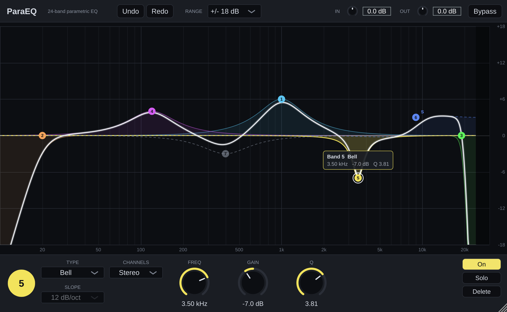

# ParaEQ (working name)

An original parametric EQ plugin (VST3, Windows, for use in Cubase), built with
JUCE and C++17. Personal-use project. No third-party EQ code, names or artwork
is used; all DSP is written from published filter maths.

**Status: Phase 4 of 10.** 24 working EQ bands (each with its own type, slope
and stereo / left / right / mid / side routing) and an interactive EQ graph.
See [docs/PHASE_REPORT.md](docs/PHASE_REPORT.md).



## Using it

- **Click** anywhere on the graph to add a band (near 20 Hz you get a low cut,
  near 20 kHz a high cut, elsewhere a bell).
- **Drag** a dot: left/right = frequency, up/down = gain. Hold **Shift** for fine moves.
- **Mouse wheel** over a dot = Q (width).
- **Double-click** a dot = reset its gain to 0 dB.
- **Right-click** a dot = type, slope, channels, enable, solo, delete.
- The panel at the bottom shows every setting of the selected band.
- **Undo / Redo** buttons, or Ctrl+Z / Ctrl+Y. **Delete** key removes the selected band.
- **Solo** plays only the frequency region of that band, so you can find what to cut.

## Quick install (no building needed)

1. Download the latest build (no GitHub sign-in needed):
   <https://github.com/Joenebula/The-EQs-filter-engine/releases/download/latest/ParaEQ-VST3-Windows-x64.zip>
2. Unzip it. Copy the `ParaEQ.vst3` folder into
   `C:\Program Files\Common Files\VST3\`.
3. In Cubase: **Studio > VST Plug-in Manager**, press **Rescan**.

## Requirements (Windows)

| Tool | Version | Notes |
|---|---|---|
| Visual Studio 2022 | 17.x | "Desktop development with C++" workload |
| CMake | 3.22 or newer | Included with Visual Studio 2022 |
| Git | any | CMake uses it to download JUCE |
| JUCE | 8.0.12 | Downloaded automatically at configure time |

The Steinberg VST3 SDK ships inside JUCE, so no separate download is needed.

JUCE licence: JUCE 8 is dual-licensed (AGPLv3 or a JUCE commercial licence,
which is free for personal use under its revenue threshold). Fine for personal
use; check the licence before ever distributing the plugin.

## Build on Windows

Open "x64 Native Tools Command Prompt for VS 2022", then:

```bat
cd ParametricEQ
cmake -B build -G "Visual Studio 17 2022" -A x64
cmake --build build --config Release
ctest --test-dir build -C Release --output-on-failure
```

The plugin is written to:

```
build\Source\ParaEQ_artefacts\Release\VST3\ParaEQ.vst3
```

## Install

Copy the whole `ParaEQ.vst3` folder to:

```
C:\Program Files\Common Files\VST3\
```

(or configure with `-DPEQ_COPY_AFTER_BUILD=ON` from an Administrator prompt to
copy it automatically). In Cubase open **Studio > VST Plug-in Manager**, press
**Rescan**, and ParaEQ appears under the vendor "Home Studio", category EQ.

## Build options

| Option | Default | Meaning |
|---|---|---|
| `PEQ_BUILD_PLUGIN` | ON | Build the VST3 (and a standalone app for quick testing) |
| `PEQ_BUILD_TESTS` | ON | Build the DSP unit tests (no dependencies) |
| `PEQ_JUCE_DIR` | empty | Use a local JUCE checkout instead of downloading |
| `PEQ_COPY_AFTER_BUILD` | OFF | Copy the VST3 into the system folder after building |

DSP tests only (fast, no JUCE download):

```bat
cmake -B build-tests -DPEQ_BUILD_PLUGIN=OFF
cmake --build build-tests --config Release
build-tests\Release\peq_tests.exe
```

## Project layout

```
CMakeLists.txt          Top-level build (DSP library, tests, plugin)
Source/
  CMakeLists.txt        Plugin target and identity (name, vendor, IDs)
  PluginProcessor.*     VST3 processor (audio, parameters, state)
  PluginEditor.*        Window (placeholder until Phase 4)
  Parameters.*          Host-automatable parameter definitions
  DSP/                  Framework-free C++ DSP, unit-tested
    Biquad.h            Coefficients, TDF-II state, response maths
    FilterDesign.*      All filter shapes and slopes
    EQBand.*            One smoothed, click-free band
    FilterEngine.*      24 bands in series with per-band channel routing
  GUI/                  EQ graph, band panel, look and feel
Resources/              (Phase 8+) presets, fonts, images
Tests/                  Dependency-free unit tests
docs/                   Phase reports and user documentation
```

The spec suggested `/Build/CMakeLists.txt`; the CMake file sits at the project
root instead, which is the standard layout and lets `build/` stay a disposable
output folder.

## Troubleshooting

- **CMake cannot download JUCE**: clone it yourself
  (`git clone --branch 8.0.12 https://github.com/juce-framework/JUCE.git`) and
  pass `-DPEQ_JUCE_DIR=C:/path/to/JUCE`.
- **Plugin not shown in Cubase**: check the folder is
  `C:\Program Files\Common Files\VST3\ParaEQ.vst3` (the whole folder), then
  rescan. Check Cubase's "Blocklist" tab in the Plug-in Manager.
- **Copy-after-build fails with access denied**: the VST3 folder needs
  Administrator rights; copy manually or run the prompt as Administrator.
