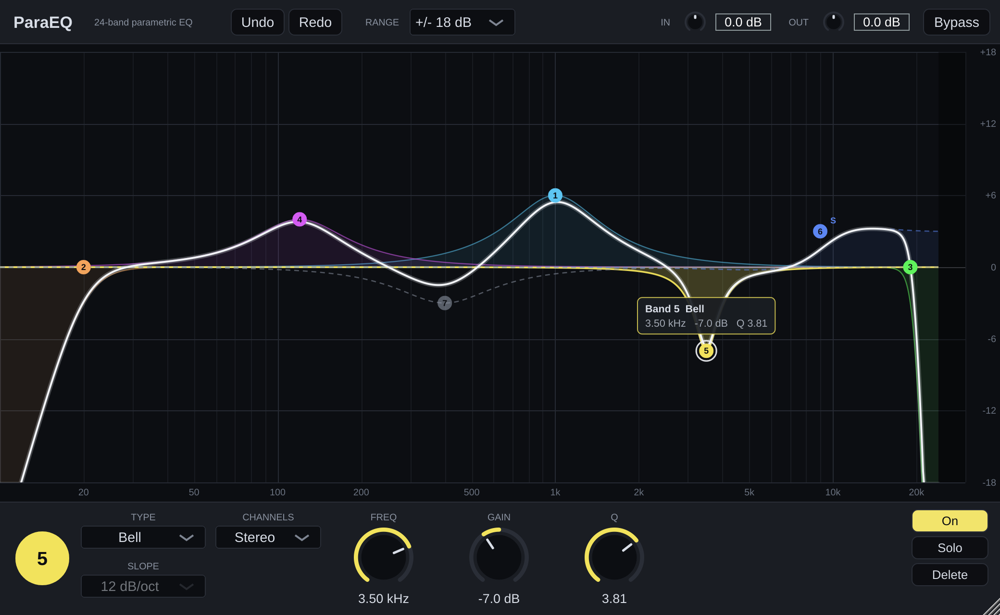

# Phase report: Phase 4 (2026-11-20)

## What was verified, and where

| Check | Result |
|---|---|
| DSP, engine and graph-maths tests, GCC 13 (Linux) | **30 tests, 191,708 checks, 0 failures** |
| Headless GUI test (real processor + editor, Linux, Xvfb) | **All 21 checks pass** (see below) |
| Visual Studio 2022 build, tests, pluginval (GitHub Actions) | See the pull request's checks |
| Cubase | Phase 1-2 build confirmed loading and working by Joe. **Phase 4 not yet tried in Cubase.** |

## Phase 4: interactive graphical interface (done)

- **EQ graph**: log frequency scale (10 Hz - 30 kHz), dB scale (choose +/-6,
  12, 18 or 30 dB), each band's curve filled in its own colour, the combined
  curve in white, the region above Nyquist shaded.
- **Nodes**: one numbered, coloured dot per band. Bypassed bands are grey and
  dashed; left/right/mid/side bands show an L/R/M/S tag and a dashed curve.
- **Mouse**: click to add a band (low cut near 20 Hz, high cut near 20 kHz,
  bell elsewhere); drag to move (horizontal = frequency, vertical = gain,
  Shift = fine); wheel = Q; double-click = reset gain; right-click menu = type,
  slope, channels, enable, solo, reset, delete. Delete key removes the
  selected band.
- **Readout** next to the hovered/selected node: band, type, frequency, gain,
  Q, slope.
- **Band panel**: type, slope, channels, frequency/gain/Q knobs, On, Solo,
  Delete for the selected band. Controls that do nothing for a type (gain on
  a cut, slope on a bell) are greyed out.
- **Top bar**: Undo / Redo (also Ctrl+Z, Ctrl+Y, Ctrl+Shift+Z), display range,
  input and output gain, bypass.
- **Solo** (listen to one band): plays the signal through a band-pass at the
  band's frequency (with its Q for bells/notches/band-passes, a wide Q for
  shelves and cuts). It is a listening aid: not automatable, not saved.
- **Resizable** window (760 x 460 up to 3000 x 2000); size and display range
  are saved with the project. Layout adapts when narrow.
- **Undo/redo** covers every edit from the graph, the panel and the top bar.

### Parameter change

Each band gained a **"Used"** parameter (`bNN_used`), separate from
**"Enabled"** (`bNN_on`). "Used" means the band exists in the graph; "Enabled"
is its bypass switch, so a band can be bypassed and still shown. A band is
heard only when both are set. All bands start unused, so a new instance is
transparent. Existing IDs are unchanged.

### GUI test (Tests/GuiTests.cpp)

Builds the real processor and editor, drives the graph through the same
functions the mouse uses, and checks the parameters: click adds a bell at the
clicked frequency and gain; clicks at 20 Hz / 19 kHz add a low / high cut;
wheel changes Q; double-click resets gain; undo and redo of a reset and of a
delete; solo on/off; 200 blocks of audio stay finite; saved state restores
frequency, Q and a bypassed band. It also saves screenshots (normal, solo,
smallest window size). It needs a display, so it runs locally, not in CI.

### Honest notes

- The combined (white) curve adds all active bands as if they all worked on
  the same signal. For left/right/mid/side bands that is only an approximation
  of what each channel gets; those bands are marked with a tag and dashed line.
- The mouse handlers themselves were exercised through the same code paths
  the GUI test calls, not by simulated mouse clicks; real-mouse feel needs
  trying in Cubase.
- Solo auditions both channels, even for a left/right/mid/side band.
- Spectrum analyser comes in Phase 5.

---

# Phase report: Phase 3 (2026-11-20)

## What was verified, and where

| Check | Result |
|---|---|
| DSP + engine tests, GCC 13 Release (Linux) | **27 tests, 191,659 checks, 0 failures** |
| Same tests with AddressSanitizer + UBSan, `-Wconversion -Wshadow -Werror` | 0 failures, no warnings, no sanitizer reports |
| Visual Studio 2022 x64 build (GitHub Actions) | Builds, no errors |
| Tests on Windows (GitHub Actions) | **27 tests, 0 failures** |
| pluginval, strictness 5 (GitHub Actions, Windows) | **Passed** (exit code 0; scan, open, editor, audio at 44.1/48/96 kHz, state, automation, buses) |
| Cubase scan / load / automation | **Not tested yet** (needs Joe's PC) |

## Phase 3: multi-band filter implementation (done)

- **24 bands** in series (`Source/DSP/FilterEngine.*`), each a Phase 2
  `EQBand`.
- **Per-band channel routing**: Stereo, Left, Right, Mid or Side. Mid/side
  conversion is only done where the chain needs it (one conversion each way
  for a run of mid/side bands). Mono tracks: every band processes the single
  channel.
- **Changing a band's routing while playing** fades the band out, swaps the
  routing, clears its memory and fades it back in (no click).
- **Host parameters**: 7 per band (On, Type, Freq, Gain, Q, Slope, Channels),
  168 in total plus input gain, output gain and bypass. Grouped per band, so
  Cubase shows them as "Band 1", "Band 2" ... Frequency and Q move evenly on a
  log scale; frequency shows as Hz/kHz. All bands start **off**, spread from
  30 Hz to 16 kHz, so a new instance is transparent.
- Signal path: input gain, 24 bands, output gain, global bypass crossfade.
- Bands that are off cost almost nothing (no filtering is run).
- **Smoother fades**: band on/off, type/slope and routing changes now use an
  S-shaped fade instead of a straight line. Click level for "bypass a +12 dB
  band" improved from -91 dB to -122 dB; for routing changes it is about
  -100 dB (vs -8 dB with no smoothing).

### New tests (Tests/EngineTests.cpp)

- All bands off: output bit-identical (stereo and mono).
- Left/Right bands change only their channel, bit-exactly matching a single band.
- Mid/Side: with L = R a Side band does nothing and a Mid band equals a Stereo
  band; with R = -L a Mid band does nothing; a Side band leaves L + R unchanged.
- 24 random bells together: measured response equals the sum of the designed
  responses within 0.02 dB at 44.1 and 96 kHz.
- A mixed Left / Mid / Side / Stereo chain matches a hand-built reference
  within 1e-12.
- Changing routing while playing is click-free (< -80 dB).
- 2 s of random automation of all 24 bands (type, slope, routing, on/off)
  every 128 samples at 44.1 and 192 kHz stays finite and bounded.

### Not in this phase (by plan)

- Band **solo** needs the graphical interface to be useful (listen to one band
  while dragging it), so it comes with Phase 4.
- The window is still JUCE's plain list of controls (scrollable, 171 entries).

### CI changes

- The Windows build now also runs **pluginval** (a widely used plugin
  validator) on the VST3.
- The download zip now unpacks straight to a `ParaEQ.vst3` folder.

---

# Phase report: Phases 1 and 2 (2026-11-20)

## What was verified, and where

Everything below was compiled and run on **Linux (GCC 13, Clang 18)** in a
cloud build machine. **Nothing has been compiled with Visual Studio or tested
in Cubase yet.** That needs a Windows machine (next step).

| Check | Result |
|---|---|
| DSP library + tests, GCC 13 Release | Compiles with no warnings (`-Wall -Wextra -Wpedantic`) |
| DSP unit tests | **20 tests, 191,614 checks, 0 failures** (0.7 s) |
| Same tests under AddressSanitizer + UndefinedBehaviourSanitizer, `-Werror` | 0 failures, no sanitizer reports |
| DSP sources with Clang `-Wconversion -Wshadow` | 0 warnings |
| JUCE 8.0.12 plugin target (VST3 + Standalone), Linux | Compiles and links with no warnings from our code. JUCE's build step loads the VST3 to generate its module info, which succeeded |
| Plugin validator (pluginval) | **Not run.** Planned on Windows |
| Visual Studio 2022 build | **Not run yet** |
| Cubase scan / load / automation | **Not tested yet** |

## Phase 1: project setup (done)

- CMake project: framework-free DSP library (`peq_dsp`), unit tests
  (`peq_tests`, registered with CTest), and the JUCE plugin (VST3 + Standalone).
- JUCE is downloaded automatically at a pinned version (8.0.12), or taken from
  a local folder.
- Plugin identity set (vendor "Home Studio", product "ParaEQ", EQ category,
  stereo and mono layouts). Names are placeholders; easy to change in
  `Source/CMakeLists.txt`.
- Working scaffold processor: double-precision internal processing,
  allocation-free audio path (large host blocks are processed in chunks),
  automatable input gain, output gain and bypass with smoothing and a
  click-free bypass crossfade, state save/restore.
- Placeholder editor (generic parameter sliders, resizable dark window).

## Phase 2: core EQ DSP (done)

Filter shapes, all double precision, transposed direct form II:

| Type | Slopes | Q | Gain |
|---|---|---|---|
| Bell | fixed 2nd order | bandwidth | ±30 dB |
| Low shelf / high shelf | 6 or 12 dB/oct | transition steepness (12 dB/oct) | ±30 dB |
| Low-pass / high-pass | 6, 12, 18, 24, 36, 48, 72, 96 dB/oct | resonance (default 0.707 = flat Butterworth) | n/a |
| Notch | fixed 2nd order | width | n/a |
| Band-pass | 6 to 48 dB/oct | -3 dB bandwidth (kept equal to fc/Q at every slope) | n/a |

- Frequency 10 Hz to 30 kHz, Q 0.025 to 40.
- `EQBand`: one band with smoothing. Frequency and Q glide in the log domain,
  gain in dB (20 ms). While gliding, the filter is redesigned every 16 samples
  and coefficients are ramped per sample in between. Bypass crossfades (10 ms).
  A type or slope change fades out, swaps the filter structure and fades back in.
- No allocation, locks or I/O in the audio path.
- `CascadeCoefficients::magnitudeDb()` gives the exact response curve; the
  GUI will use the same function to draw curves (Phase 4).

### What the tests check

Expected values come from closed-form maths, so most checks are exact to
1e-6 dB or better, at all six sample rates (44.1 to 192 kHz):

- Bell gain at the centre frequency; Q sets the half-gain bandwidth.
- Shelf gain at DC, Nyquist and the midpoint (both slopes).
- Low/high-pass: the whole curve equals a Butterworth response, -3 dB at the
  cutoff, slope per octave matches the setting; Q gives the expected resonance.
- Notch null depth and -3 dB width; band-pass unity gain and -3 dB width at
  every slope.
- Stability of 181,440 designs across the full parameter range.
- Processing a real sine signal through a band matches the designed curve
  within 0.01 dB.
- Smoothing settles exactly on target.
- Click test: a high-frequency "click detector" on a 100 Hz tone while
  parameters jump. Results (lower is better):

  | Change | Smoothed | Without smoothing |
  |---|---|---|
  | Gain 0 to +24 dB | -131 dB | -80 dB |
  | Frequency 100 Hz to 3 kHz | -123 dB | -55 dB |
  | Bypass a +12 dB band | -91 dB | -47 dB |
  | Bell to 48 dB/oct high-pass | -87 dB | -65 dB |

- 5 seconds of random automation every block at every sample rate stays finite
  and bounded.
- Stereo channels are independent; disabled bands are bit-transparent;
  sample-rate changes re-design correctly.

## Technical compromises (honest list)

1. **High-frequency cramping.** These are bilinear-transform filters. Gain at
   the centre frequency is exact, but a wide bell near the top of the range
   (e.g. 15 kHz at 44.1 kHz) is narrower on its upper side than the analogue
   ideal. Planned fix: optional oversampling (Phase 6/9) and/or "matched"
   filter designs.
2. **30 kHz needs a high sample rate.** Bands are capped at 0.49 × sample rate
   (21.6 kHz at 44.1 kHz). The full 30 kHz is available from 88.2 kHz up.
3. **Shelves offer 6 or 12 dB/oct only.** Steeper shelves are not a simple
   cascade; Q controls the 12 dB/oct shelf's steepness instead.
4. **Type or slope changes fade through dry** for about 20 ms, because the
   number of filter sections changes and can't be glided.

## Outstanding / next

- Phase 3: 24-band engine, per-band parameters registered with the host,
  stereo / left / right / mid / side routing per band.
- Windows: build with Visual Studio 2022, run tests and pluginval, then load
  in Cubase.
