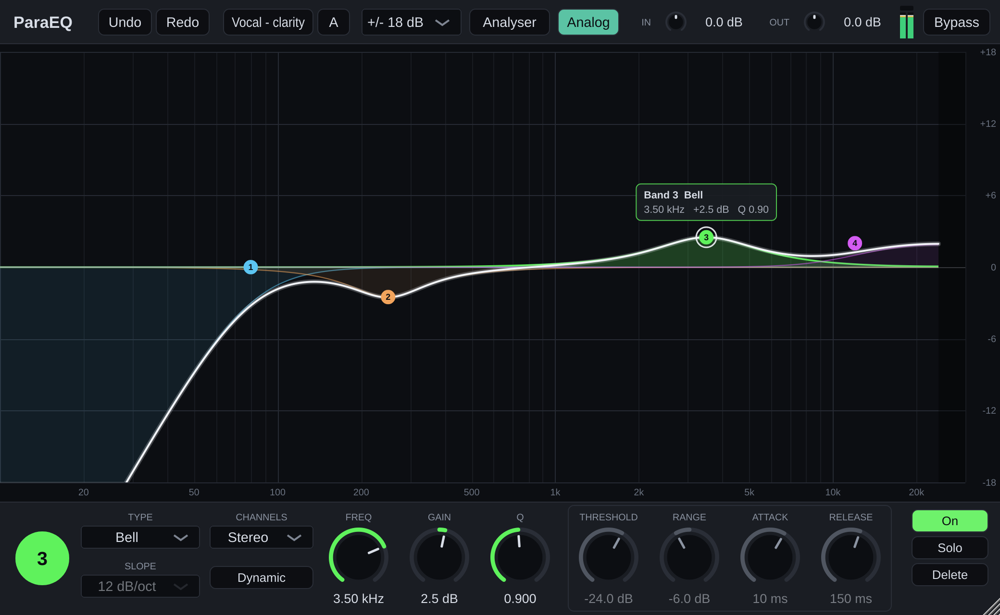
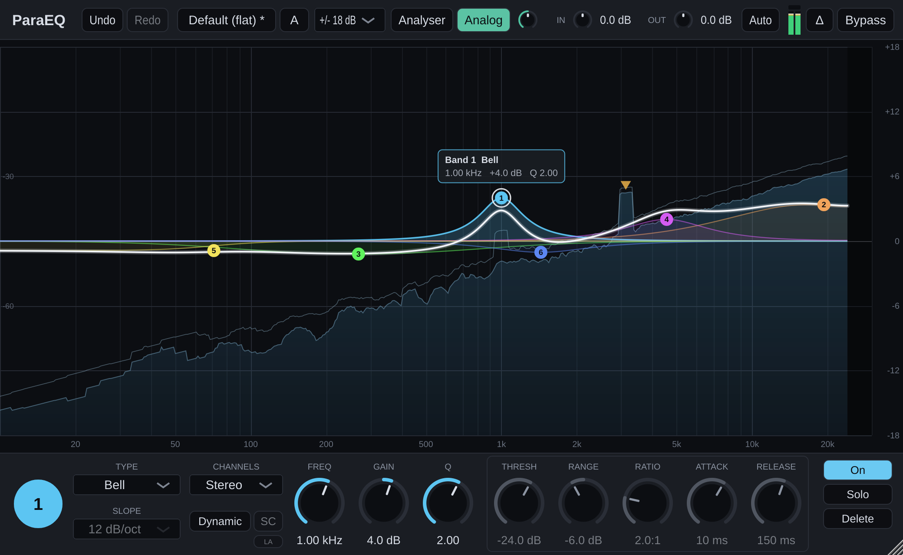
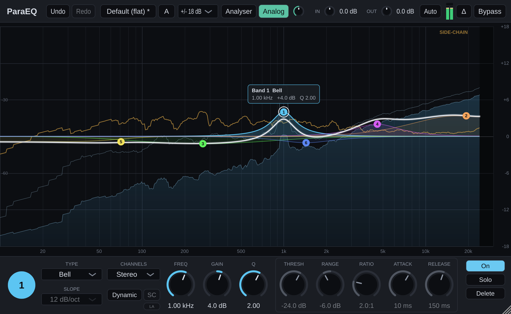
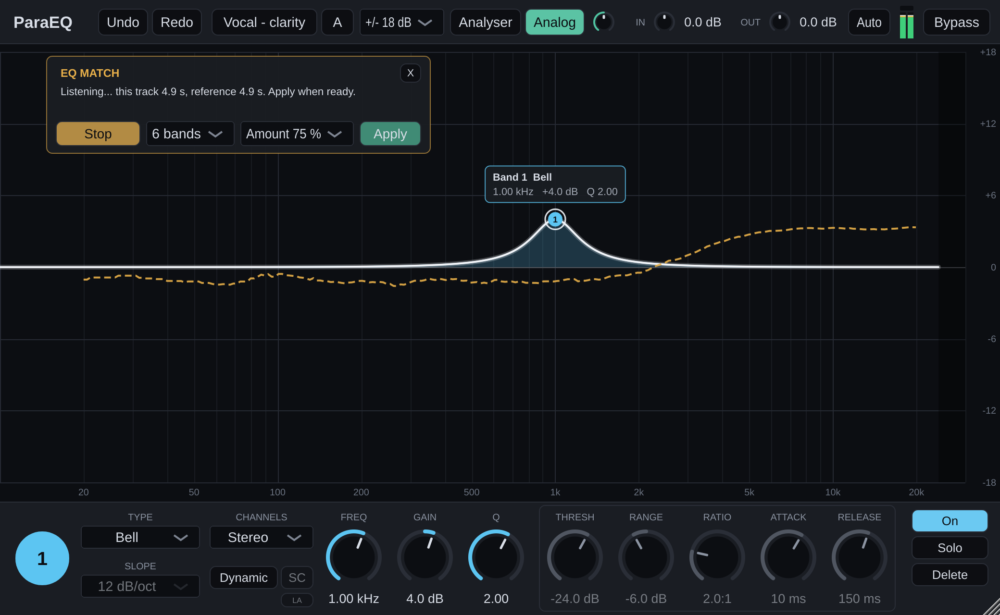

# ParaEQ user manual

ParaEQ is a 24-band parametric EQ plugin (VST3, 64-bit Windows) made for
Cubase. It has a large interactive EQ graph, a real-time spectrum analyser,
dynamic EQ on any bell or shelf (with an external sidechain), left/right/mid/side processing per band,
presets, A/B compare and full automation.

Version 1.9 · Vendor "Home Studio" · Personal use.

---

## 1. Installing

### With the installer (recommended)

1. Close Cubase.
2. Download **ParaEQ-Setup-Windows-x64.exe** and run it. Windows may warn
   that the app is from an unknown publisher (the installer is not code-signed).
   Click **More info > Run anyway**.
3. Click through the installer. It puts:
   - the plugin in `C:\Program Files\Common Files\VST3\ParaEQ.vst3`
   - this manual in `C:\Program Files\Home Studio\ParaEQ`, with a Start menu
     shortcut.
4. Start Cubase. ParaEQ appears in the plugin list under **EQ**, vendor
   **Home Studio**. If it doesn't, open **Studio > VST Plug-in Manager** and
   click **Rescan**.

### By hand (zip file)

Unzip **ParaEQ-VST3-Windows-x64.zip** and copy the `ParaEQ.vst3` folder into
`C:\Program Files\Common Files\VST3\`. Then rescan in Cubase as above.

### Updating

Close Cubase and run the new installer (or copy the new `ParaEQ.vst3` over the
old one). Your projects and presets are kept. Projects saved with an older
ParaEQ open with the same sound.

### Uninstalling

**Windows Settings > Apps > ParaEQ > Uninstall**. Your own presets stay in
`%APPDATA%\Home Studio\ParaEQ\Presets`; delete that folder if you don't want
them.

---

## 2. The window

From left to right along the top:

| Control | What it does |
|---|---|
| **Undo / Redo** | Steps back or forward through your changes (Ctrl+Z, Ctrl+Y). |
| **< Preset name >** | Click the name for the preset menu; the arrows step through presets. A **\*** after the name means you've changed something since loading it. |
| **A** / **B** | Switches between two complete settings to compare them. |
| **+/- 18 dB** | Vertical scale of the graph (6, 12, 18 or 30 dB). Display only. |
| **Analyser** | Spectrum analyser settings. |
| **Analog** / **Classic** / **Linear** | Curve type menu: **Analog** (analog-matched curves, the default), **Classic** (plain digital curves) or **Linear** (linear phase). See below. |
| Scale knob | **Gain Scale**: makes every band's boost or cut bigger or smaller together, 0 to 200 %. 100 % = as set, 0 % = flat. Double-click for 100 %. Saved in presets. |
| **IN / OUT** | Input and output gain, -24 to +24 dB. Double-click to reset. |
| **Auto** | **Auto Gain**: keeps the overall level the same as you EQ, so you hear the tone change rather than "louder = better". Hover over it to see the correction it's applying. Off by default. |
| **Δ** (Delta) | **Delta listen**: hear only what the EQ changes. See below. Not saved; switches off when the window closes. |
| Meter | Output peak level. Red light = went over 0 dBFS; click to reset. |
| **Bypass** | Turns the whole EQ off (click-free). |

The window can be resized from its bottom-right corner. Its size is saved with
the project.

### Delta listen (Δ)

With **Δ** on, you hear only the *difference* the EQ makes: what a cut takes
away, or what a boost adds, and nothing else. It's the quickest way to check
that a cut is removing the boxiness or ring you're after and not the body of
the sound, or that a boost isn't mostly adding hiss. "DELTA" shows at the top
left of the graph while it's on.

- With the EQ flat, you hear silence.
- The output gain (OUT and Auto Gain) is not applied, so you hear the change at
  its real level. It works in every curve type, Linear included.
- It's a listening aid, like Solo: it isn't saved, and it switches off when
  you close the window. Don't leave it on while bouncing.

### Auto Gain

A boost makes things louder, and louder usually sounds "better", which
makes it hard to judge an EQ move honestly. With **Auto** on, ParaEQ turns
its output down (or up) by about as much as the EQ curve adds (or takes
away), so switching Bypass compares tone, not loudness.

It is worked out from the curve, not by listening to the audio, so it never
pumps. A broad boost gets a bigger correction than a narrow one, because it
changes the loudness more. It is an estimate for typical full-range music;
on a narrow source (a bass on its own, a hi-hat) the real level change can
differ. Dynamic bands count at their set Gain. The correction comes on top
of **OUT**. It is saved with the project but not in presets.

### Analog-matched curves

A normal digital EQ "squeezes" bands near the top of the spectrum: at 44.1
or 48 kHz a wide bell at 12 kHz comes out narrower than it should, and a high
shelf can't keep rising past about 18 kHz. With **Analog** on (the default),
every band keeps the shape an analogue EQ would have, right up to 20 kHz. There
is no added latency and no extra CPU worth measuring.

Choose **Classic** in the curve menu for the plain digital curves. Projects
made with ParaEQ 1.0 open as Classic, so they sound exactly as they did. The
curve type is not part of a preset.

### Linear phase

A normal EQ (Analog or Classic) shifts the timing of the frequencies it
changes a little. That's how analogue EQs behave too, and it's usually what you
want. Choose **Linear** in the curve menu when it matters that nothing is
smeared in time: mastering, parallel or multi-mic sources (where the EQ'd copy
is mixed with an un-EQ'd one), or big low cuts on drums.

- The curve is the same shape as **Analog**; only the timing changes.
- It adds about **91 ms** of latency (4352 samples at 44.1/48 kHz, 8448 at
  88.2/96 kHz). Cubase compensates for it on playback, but it's not for
  recording or live monitoring. **Switch modes while playback is stopped**;
  switching while playing causes a short jump while Cubase catches up.
- Static bands set to **Stereo** go linear phase. Dynamic bands and bands set
  to L, R, Mid or Side stay as normal EQ, so they still react instantly.
- When you move a band, the new curve fades in within about 40 ms instead
  of gliding, so very fast automation on a linear band sounds steppy.
- Very narrow moves below about 50 Hz come out a little softer than set
  (the filter can only be so long).
- It uses more CPU: about 4 % of one core for a busy instance on the test
  machine, against under 2 % for the normal modes.

---

## 3. Working with bands

### Adding and moving

- **Click** an empty spot on the graph to add a band there. Near 20 Hz you
  get a low cut, near 20 kHz a high cut, anywhere else a bell.
- **Drag** a dot: left/right changes the frequency, up/down the gain. Hold
  **Shift** for fine moves. Hold **Alt** while you start the drag and up/down
  changes the Q instead (up = narrower).
- **Arrow keys** move the selected band: left/right one semitone, up/down
  0.5 dB (with Shift: a quarter semitone and 0.1 dB).
- Hover over an empty spot to see the frequency, the musical note and the
  level at the mouse (bottom left of the graph).
- **Mouse wheel** over a dot changes the Q (width). Higher Q = narrower.
- **Double-click** a dot to reset its gain to 0 dB.
- **Right-click** a dot for type, slope, channels, enable, solo, copy,
  paste and delete.
- **Delete** key removes the selected band.

### The band panel

The strip at the bottom shows every setting of the selected band:

- **Type**, **Slope**, **Channels** (see below).
- **Dynamic** switch and its four knobs (section 4).
- **Freq**, **Gain**, **Q** knobs.
- **On** (bypass just this band), **Solo**, **Delete**.

Double-click a knob to reset it. Drag up/down or left/right to turn it.

### Filter types

| Type | Use | Gain | Slope |
|---|---|---|---|
| Bell | Boost or cut around a frequency | yes | - |
| Low Shelf | Boost or cut everything below | yes | 6 or 12 dB/oct |
| High Shelf | Boost or cut everything above | yes | 6 or 12 dB/oct |
| High-pass (low cut) | Remove rumble and low end | - | 6 to 96 dB/oct |
| Low-pass (high cut) | Remove highs | - | 6 to 96 dB/oct |
| Notch | Remove one narrow frequency (hum, ring) | - | - |
| Band-pass | Keep only a region | - | 6 to 48 dB/oct |

### Channels (per band)

| Setting | The band works on |
|---|---|
| Stereo | Both channels together (normal) |
| Left / Right | One channel only |
| Mid | What's in the centre (vocals, kick, bass, snare) |
| Side | What's at the sides (width, reverb, wide guitars) |

Bands that aren't Stereo show a small letter (L, R, M, S) next to their dot
and a dashed curve. The white combined curve treats all bands as if they were
Stereo, so for L/R/M/S bands it's a guide, not exact.

### Solo

**Solo** (panel button or right-click) plays only the frequency region of
that band. It's a quick way to find a harsh or muddy area. Click again to
stop. Solo is a listening aid; it isn't saved or automated.

### Copy and paste

Right-click a dot and choose **Copy band**, or select it and press **Ctrl+C**.
**Ctrl+V** pastes it as a new band; right-click another dot and choose
**Paste onto this band** to replace it. This also works between two ParaEQs
in the same project.

(Ctrl+C / Ctrl+V only reach ParaEQ when its window has keyboard focus; click
the graph first. The right-click menu always works.)

---

## 4. Dynamic EQ

A dynamic band only acts when its frequency region gets loud. It works on
bells and shelves.

1. Select a bell or shelf and click **Dynamic** in the band panel.
2. **Threshold**: the level (in dBFS of that region) where it starts to act.
   The live bar under the Dynamic button shows the gain change as it happens;
   set the threshold so it moves on the loud parts only.
3. **Range**: the most the gain may move. Negative turns the band **down**
   when loud (taming harsh "s" sounds, a boomy note). Positive turns it **up**
   when loud.
4. **Ratio**: how hard it reacts once over the threshold, from 1:1 (not at
   all) to 20:1. At 2:1 (the default) the gain moves 1 dB for every 2 dB
   over; at 4:1, 3 dB for every 4 dB. It never goes past Range.
5. **Attack**: how fast it reacts (0.1 to 200 ms).
   **Release**: how fast it lets go (5 ms to 2 s).
6. **SC** (next to Dynamic): listen to the **sidechain** input instead of
   the band's own audio. See below.
7. **LA** (next to the live bar): **look-ahead** for all dynamic bands. See
   below.

The band's normal **Gain** still applies: the dynamics move away from it. For
example, Gain +3 dB with Range -6 dB gives +3 dB on quiet parts and down to
-3 dB on loud parts. Gain Scale scales the Gain, not the Range.

On the graph a dynamic band shows:

- a bar from its dot to where its range ends,
- a dotted curve for the full range,
- live, the curve it is applying right now (shaded).

How it works: each dynamic band listens to its own frequency region (a
band-pass at the band's frequency and Q for a bell, low or high frequencies
for a shelf). L/R/M/S bands listen only to their own channel. Above the
threshold the gain moves by the ratio (1 dB for every 2 dB over at 2:1),
with a soft knee, up to the range.

### Look-ahead

A dynamic band normally reacts *after* a loud sound starts, so the first
few milliseconds of a sharp hit (a snare, a hard "t" or "s") can slip
through. With **LA** on, ParaEQ delays its audio by 5 ms while the dynamic
bands listen to the undelayed signal, so they are already moving when the
sound arrives. In the tests the first 2 ms of a sudden loud tone came
through about 6 dB quieter with look-ahead than without.

- It applies to every dynamic band in this ParaEQ (the button is the same
  on every band).
- It adds **5 ms of latency** while on. Cubase compensates it automatically
  (playback stays in time), but you'll feel it if you monitor a live input
  through ParaEQ while recording. Off = zero latency, as before.
- With look-ahead on, dynamic bands listen to ParaEQ's input rather than to
  the output of the bands before them.
- It is saved with the project, not in presets, and can't be automated
  (changing the latency during playback would upset the timing).

### Sidechain (another track controls the band)

With **SC** on, a dynamic band reacts to a *different* track, sent to
ParaEQ's sidechain input. The classic use: duck the bass guitar's low end
only when the kick drum hits, so the two don't fight.

1. On the bass track, add a low-shelf or a bell around 60 to 100 Hz, click
   **Dynamic**, set Range to about -6 dB, and click **SC**.
2. In Cubase, click the **side-chain** button at the top of ParaEQ's window
   frame (the plugin window title bar) to activate the side-chain input.
3. On the kick track, add a **Send** and pick the bass track's
   *ParaEQ - Side-Chain* as its destination, then turn the send up. Pre-fader works best, so the
   kick's own volume fader doesn't change the ducking.
4. Play both and lower **Threshold** until the band moves on each kick.

The sidechain still goes through the band's own detector filter, so a 80 Hz
bell listens to the kick's 80 Hz region, not its click. The band's Channels
setting decides what it *changes*; the sidechain's left and right are
always heard together. If **SC** is on but nothing is routed (or the
side-chain is not activated), the band hears silence and stays at its set
Gain. The graph readout shows "(SC)" for such bands.

---

## 5. Spectrum analyser

The analyser draws what's playing behind the EQ curves. The filled shape is
the **output** (after the EQ), the grey line the **input** (before it). The
scale on the left is dBFS (0 at the top, -90 at the bottom).

Settings (**Analyser** button):

| Setting | Choices |
|---|---|
| Show | Off, Post-EQ, Pre + Post, Pre-EQ |
| Resolution | 2048 to 16384 points. Higher = more detail in the lows, slower |
| Speed | How fast the display falls back |
| Smoothing | Off, 1/12, 1/6 or 1/3 octave |
| Tilt | 0, 3 or 4.5 dB/oct (makes typical music look flat; display only) |
| Opacity | 25 to 100 % |
| Peak hold | A thin line showing recent peaks |
| Find resonances | Marks rings in the spectrum with small amber triangles; click one to cut it (see below) |
| Show side-chain | Also draws the track on ParaEQ's side-chain input, as an amber line (see below) |
| EQ Match | Opens the EQ Match panel (see below) |

The analyser only runs while the window is open.

### Finding resonances

With **Find resonances** ticked, ParaEQ watches the spectrum (the output, or
the input if only Pre-EQ is shown) over the last couple of seconds and puts a
small amber triangle over any narrow peak that sticks out at least 6 dB above
the music around it: a ringing snare, a boomy room note, a whistle in a
vocal. Hover over a marker to see its frequency and how far it sticks out.
**Click a marker** to add a narrow cut there (a bell, roughly three quarters of
the peak deep, between 3 and 12 dB, with a Q to match its width). It's an
ordinary band, so adjust it to taste, and Undo removes it.

Markers move as the music changes, and rings a band is already cutting are
not marked. Steady notes in the music (a held bass note, a sustained vocal)
can look like rings too, so listen before you cut: **Δ** (Delta listen) is
handy for checking what the cut removes. Only 40 Hz to 16 kHz is searched.

### Seeing another track (side-chain)

With **Show side-chain** ticked, the analyser also draws whatever is sent to
ParaEQ's side-chain input, as an amber line labelled SIDE-CHAIN. Use it to see
where two parts fight: put ParaEQ on the bass, send the kick to its
side-chain, and the places where the amber line and the bass's spectrum are
both high are where to cut (or to set a dynamic band with **SC**). Set up the
side-chain the same way as for Dynamic EQ (see "Sidechain" above). Nothing
shows until the side-chain is activated in Cubase and something is sent to it.
The setting is saved with the project, like the other analyser settings.

### EQ Match (make this track sound like a reference)

EQ Match listens to this track and to a **reference** track (a mix you like,
another take, the same instrument from another song) and adds bands that
move this track's tone towards the reference's. It matches the tonal
balance only, not the level.

1. In Cubase, activate ParaEQ's **side-chain** (button at the top of the
   plugin window frame) and send the reference track to *ParaEQ -
   Side-Chain* with a send, as for the sidechain in Dynamic EQ.
2. Open **Analyser > EQ Match**. Choose how many bands it may use (4 to 12)
   and the **Amount** (75 % is a good start; 100 % copies the difference
   fully, which can sound overdone).
3. Click **Learn** and play. The two can play together, or one after the
   other (for example, solo the reference for a while, then play the track);
   silent parts are ignored. The panel counts the seconds learned for each.
   Ten seconds or more of typical material works best.
4. The dashed orange line on the graph shows the correction learned so far.
   Click **Apply** to add the bands. They go into free bands only (your own
   bands are left alone), as ordinary bands you can adjust or delete.
   **Undo** takes them all away in one step.

Closing the panel stops listening. What it learned is kept until you click
Learn again, so you can Apply again with a different number of bands or
Amount (undo the first set first). The correction is limited to +/-12 dB,
and only the range where both tracks have real content is matched.

---

## 6. Presets

Click the preset name for the menu:

- **Factory presets**: 14 starting points (vocals, drums, bass, guitar,
  master, effects). Load one and adjust it to your track.
- **My presets**: presets you saved.
- **Save** (overwrite the current user preset), **Save as...** (new name),
  **Rename...**, **Delete** (goes to the Recycle Bin).
- **Import...** / **Export...**: `.paraeq` files, to share or back up.
- **Show presets folder**: `%APPDATA%\Home Studio\ParaEQ\Presets`.

A preset holds all bands, dynamics and the IN/OUT gain. It doesn't change
Bypass, the window size or the analyser settings. Loading a preset can be
undone with Undo.

Cubase's own preset menu (at the top of the plugin window) also works; it saves
everything, including the window and analyser settings.

## 7. A/B compare

Click **A** to switch to **B**. The first time, B starts as a copy of A. Make
changes, then switch back and forth to compare. **Copy A to B** (or B to A)
is in the preset menu. Both settings are saved with the project.

---

## 8. Using ParaEQ in Cubase

- **Insert it** on any mono or stereo audio track, group, FX channel or the
  stereo out.
- **Automation**: every setting can be automated. Use **Write** (W) on the
  track and move a knob or a dot. The parameters are named "Band 1 Freq",
  "Band 1 Gain", and so on, grouped by band.
- **Side-chain**: ParaEQ has an optional side-chain input for dynamic
  bands set to **SC** (see Dynamic EQ). It is off until you activate it.
- **Latency**: zero, unless **LA** (look-ahead) is on, which adds 5 ms, or
  the curve type is **Linear**, which adds about 91 ms. Cubase compensates
  for both. With neither on, it's safe for recording and live monitoring.
  Change these while playback is stopped.
- **64-bit processing**: supported (Studio > Studio Setup > Audio System >
  Processing Precision). ParaEQ works in 64-bit inside either way.
- **Sample rates**: anything from 22.05 to 192 kHz. Bands above what the
  sample rate allows are limited automatically.
- **CPU**: very light. A fully loaded instance (24 bands, half of them
  dynamic) measured about 1.5 % of one CPU core on the test machine.
- **Projects** save all settings, the preset name, A/B, window size and
  analyser settings.

## 9. Keyboard shortcuts

| Keys | Action |
|---|---|
| Ctrl+Z | Undo |
| Ctrl+Y or Ctrl+Shift+Z | Redo |
| Delete / Backspace | Delete the selected band |
| Ctrl+C | Copy the selected band |
| Ctrl+V | Paste a copied band as a new band |
| Shift + drag | Fine adjustment |
| Alt + drag | Change Q (up = narrower) |
| Left / Right arrow | Selected band down / up a semitone (Shift: 1/4) |
| Up / Down arrow | Selected band +/- 0.5 dB (Shift: 0.1 dB) |

## 10. Troubleshooting

| Problem | Try this |
|---|---|
| ParaEQ isn't in the plugin list | Check `C:\Program Files\Common Files\VST3\ParaEQ.vst3` exists, then Studio > VST Plug-in Manager > Rescan. Make sure Cubase is 64-bit. |
| Installer says "Error 183" (ParaEQ.vst3 already exists) | Fixed in the current installer, which removes any old ParaEQ.vst3 first. With an older installer: cancel, delete `C:\Program Files\Common Files\VST3\ParaEQ.vst3` (file or folder), run it again. |
| Cubase lists it as blocked | In the Plug-in Manager, select ParaEQ in the blocklist and click "Reactivate". |
| No sound change | Is **Bypass** on? Is the band's **On** button on? Is the band set to Side on a mono source? |
| The analyser is flat | It only shows while audio plays and the window is open. Check Analyser > Show isn't Off. |
| Ctrl+Z undoes something in Cubase instead | Click inside the ParaEQ window first, or use the Undo button. |
| A band set to **SC** never moves | Activate the side-chain on ParaEQ's window frame in Cubase, check the other track's send goes to *ParaEQ - Side-Chain* and is turned up, then lower **Threshold**. |
| Everything sounds late or out of sync after choosing **Linear** | Stop and start playback so Cubase picks up the new latency. Don't use Linear while recording. |
| Output meter shows red | The output went over 0 dBFS. Lower **OUT** or the boosts. |

## 11. Known limitations

- Automation is applied once per audio block and glided over about 20 ms, so
  it's smooth but not sample-accurate.
- Look-ahead is fixed at 5 ms. The dynamic knee (6 dB) is fixed.
- Auto Gain is an estimate from the curve, not a loudness measurement.
- EQ Match needs the reference on the side-chain, matches the long-term
  average only (not dynamics or stereo), and learns again from scratch at a
  new sample rate.
- Linear phase applies only to static Stereo bands, its latency is fixed per
  sample rate, and its curve changes fade in rather than glide.
- The combined curve is exact only for Stereo bands.
- Analog-matched curves are very close to analogue but not perfect for
  bands centred right next to the top of the spectrum (about 1 dB on an
  everyday bell or shelf, more for extreme settings).
- The installer and plugin are not code-signed, so Windows shows a warning
  the first time.
